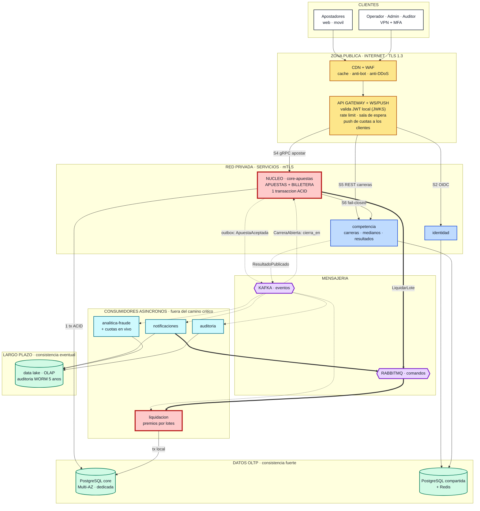
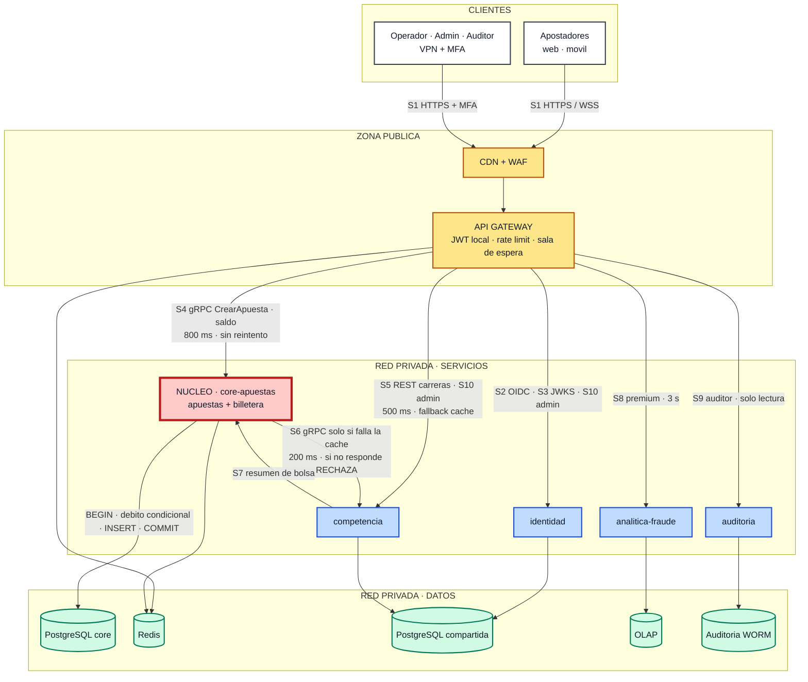
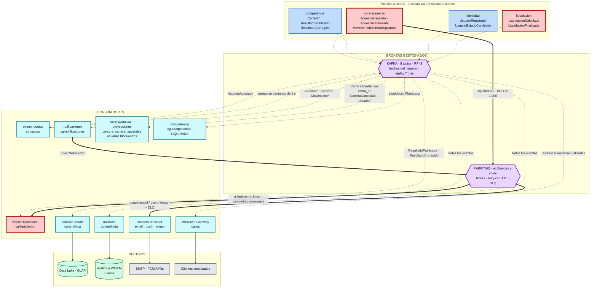
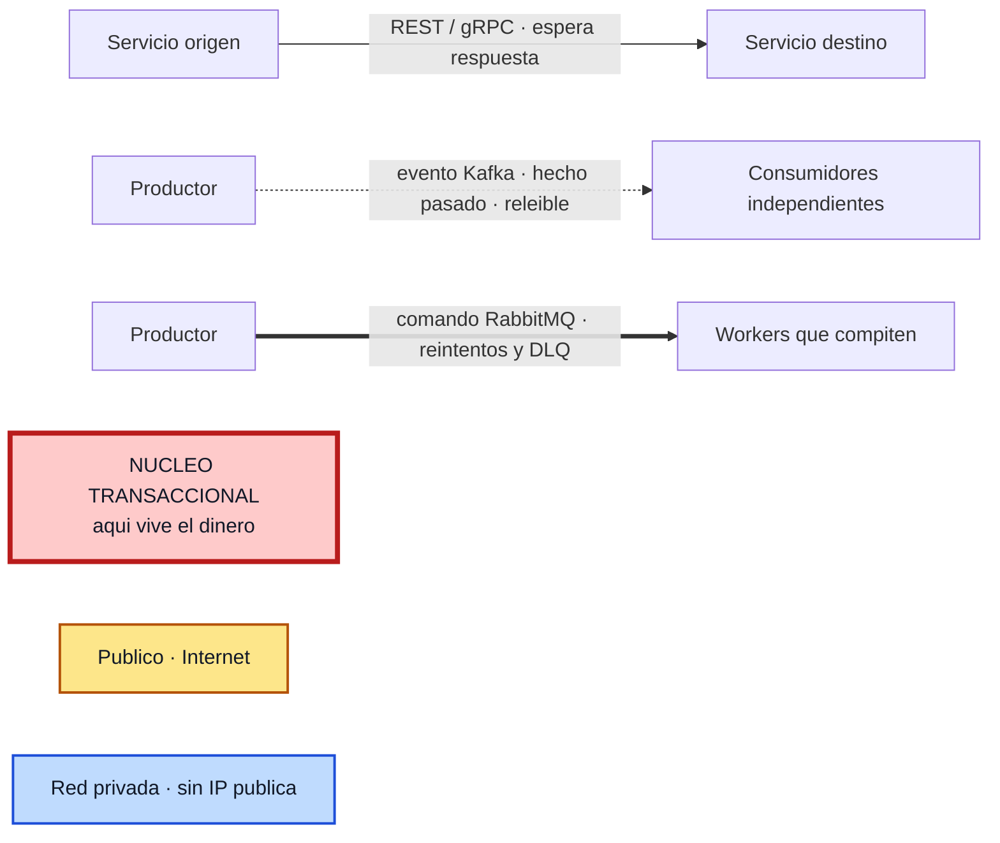

# Diagrama general de arquitectura — Plataforma de Apuestas "La Gran Liga de Medianos EIA"

> Derivado de `decisiones-arquitectura.md` (Anexo A.1). Cubre el entregable 12.1 del enunciado:
> flujo **Cliente → API/Gateway → Servicios → Bases de datos → Kafka/RabbitMQ → Consumidores**, con **distinción visual entre comunicación síncrona y asíncrona**.

## Convención visual (obligatoria para la sustentación)

| Trazo / color | Significado |
|---|---|
| ──────► línea continua | **Síncrono** — HTTPS/REST o gRPC. El origen espera la respuesta |
| ╌╌╌╌╌► línea discontinua | **Asíncrono — evento de dominio** en **Kafka** (hecho en pasado, multi-consumidor, releíble) |
| ══════► línea gruesa | **Asíncrono — comando** en **RabbitMQ** (tarea a ejecutar, con reintentos y DLQ) |
| Caja roja de borde grueso | **Núcleo transaccional**: aquí vive el dinero y la única transacción ACID del camino crítico |
| Zona amarilla | **Público (Internet)** |
| Zonas azul · verde · violeta · celeste | **Red privada**, sin IP pública |

Las etiquetas usan códigos cortos (`S1`…`S10` para lo síncrono, nombres de evento y `cg-*` para lo asíncrono). El detalle completo de cada arista está en la **§5**, para que los diagramas quepan en una diapositiva sin perder información.

**Se entregan tres vistas del mismo sistema**, porque un único diagrama con las 45 aristas resulta ilegible al proyectarlo:

| Vista | Para qué sirve | Diapositiva sugerida |
|---|---|---|
| **1. Integrada** (§1) | El diagrama general: las 7 zonas, los 6 servicios, las bases de datos, los dos brokers y los consumidores, con los tres tipos de trazo | La que acompaña la explicación de la arquitectura |
| **2. Camino crítico síncrono** (§2) | Demuestra que apostar no cruza ninguna frontera de red entre servicios y que se cumple el SLA de <1 s | La que acompaña "cómo se acepta una apuesta" |
| **3. Flujo asíncrono** (§3) | Demuestra el desacoplamiento: quién publica, qué broker y qué consumer group lee cada evento | La que acompaña "eventos y mensajería" |

---

## 1. Vista integrada — el diagrama general

---

## 2. Vista del camino crítico (solo comunicación **síncrona**)

Todo lo que aquí aparece ocurre **dentro del segundo** que el usuario espera. Obsérvese que desde `core-apuestas` solo sale **una** flecha hacia otro servicio (S6), y es excepcional.

---

## 3. Vista del flujo **asíncrono** (eventos y comandos)

Nada de lo que aquí aparece está en el camino crítico de una apuesta: todo esto puede retrasarse o caerse sin que nadie deje de apostar.

---

## 4. Leyenda (bloque aparte, para proyectar al lado)

---

## 5. Detalle de las aristas (lo que las etiquetas cortas abrevian)

### 5.1 Aristas síncronas

| Código | Origen → Destino | Protocolo | Qué pide | Timeout y fallback |
|---|---|---|---|---|
| S1 | Cliente → CDN/Gateway | HTTPS + WSS | Todas las operaciones del usuario | 2 s; reintento con la **misma** `Idempotency-Key` |
| S2 | Gateway → identidad | OIDC/REST | Login, refresh, registro | 1 s, 1 reintento. Si cae: no hay logins nuevos, **las sesiones vigentes siguen** |
| S3 | Gateway → identidad | HTTP (JWKS) | Claves públicas, **cada 10 min, cacheadas** | Caché + claves anteriores retenidas: no es una llamada por petición |
| S4 | Gateway → core-apuestas | **gRPC** | `CrearApuesta`, saldo, mis apuestas, movimientos | **800 ms, sin reintento en escritura**; circuit breaker → `503 Retry-After` |
| S5 | Gateway → competencia | REST | Carreras, detalle, ficha e historial de medianos | 500 ms, 1 reintento; fallback a caché CDN/Redis |
| S6 | **core-apuestas → competencia** | gRPC | `ObtenerCarreraApostable` — **solo si falla la proyección local** | 200 ms, 1 reintento. Si falla: **se rechaza la apuesta (fail-closed)** |
| S7 | competencia → core-apuestas | gRPC | Resumen de la bolsa para el panel del operador | 1 s; muestra el último valor conocido como "aproximado" |
| S8 | Gateway → analitica-fraude | REST | Estadísticas premium, tendencias | 3 s; fallback al reporte precalculado del día anterior |
| S9 | Gateway → auditoria | REST **solo lectura** | Registro inalterable, reconstrucción de premios | 10 s; respuesta paginada o exportación asíncrona |
| S10 | Gateway → identidad / competencia | REST + MFA | Roles, bloqueos, crear/abrir/cancelar carrera, publicar resultado | 2 s, sin reintento automático; con clave de idempotencia |

### 5.2 Aristas asíncronas — Kafka

**Producción** (siempre vía *transactional outbox*: el evento se escribe en la misma transacción que el cambio de negocio):

| Productor | Eventos | Topic | Clave de partición |
|---|---|---|---|
| core-apuestas | `ApuestaAceptada`, `ApuestaRechazada` | `apuestas.aceptadas` (24p), `apuestas.rechazadas` (6p) | `carreraId` |
| core-apuestas | `MovimientoBilleteraRegistrado` | `billetera.movimientos` (24p) | `usuarioId` |
| competencia | `CarreraProgramada`, `CarreraAbierta`, `CarreraCerrada`, `CarreraIniciada`, `CarreraCancelada` | `competencia.carreras` (6p) | `carreraId` |
| competencia | `ResultadoPublicado`, `ResultadoCorregido` | `competencia.resultados` (6p) | `carreraId` |
| identidad | `UsuarioRegistrado`, `UsuarioEstadoCambiado` | `identidad.usuarios` (3p) | `usuarioId` |
| liquidación | `LiquidacionCalculada`, `LiquidacionFinalizada` | `liquidacion.eventos` (6p) | `carreraId` |
| stream-cuotas | `CuotasEstimadasActualizadas` | `cuotas.estimadas` (6p, compactado) | `carreraId` |

**Consumo** (cada grupo avanza a su propio ritmo sobre el mismo log):

| Consumer group | Servicio | Qué consume y para qué |
|---|---|---|
| `cg-core` | core-apuestas | `CarreraAbierta` (**trae `cierra_en` y participantes** → proyección apostable), `CarreraCerrada`, `CarreraCancelada` (devolución 100 %), `Usuario*` (bloqueados) |
| `cg-liquidacion` | worker-liquidacion | `ResultadoPublicado` y `ResultadoCorregido` → dispara el cálculo pari-mutuel |
| `cg-competencia` | competencia | `LiquidacionFinalizada` → la carrera pasa a **LIQUIDADA** |
| `cg-cuotas` | stream-cuotas | `ApuestaAceptada` → agregación en ventanas de 1 s |
| `cg-ws` | WS/Push Gateway | `CuotasEstimadasActualizadas`, `CarreraCerrada`, `CarreraIniciada` → push a 100.000 clientes |
| `cg-notificaciones` | notificaciones | `ApuestaAceptada`, `Carrera*`, `ResultadoPublicado`, `MovimientoBilleteraRegistrado` (filtra premio y devolución) |
| `cg-analitica` | analitica-fraude | **Todos** los eventos → data lake, OLAP y reglas de fraude |
| `cg-auditoria` | auditoria | **Todos** los eventos → almacén WORM con cadena de hashes |

### 5.3 Aristas asíncronas — RabbitMQ

| Comando | Exchange (tipo) | Routing key | Cola → consumidor |
|---|---|---|---|
| `LiquidarLote` | `liquidacion` (direct) | `liquidacion.lote` | `q.liquidacion.lotes` → **N workers que compiten** (prefetch 10) → `q.liquidacion.lotes.dlq` |
| `EnviarNotificacion` | `notificaciones` (topic) | `notif.email.*`, `notif.push.*`, `notif.inapp.*` | `q.notif.email` / `q.notif.push` / `q.notif.inapp` → workers de canal → `q.notif.retry` (TTL 5 s/30 s/5 min) → `q.notif.dlq` |
| `RecalcularEstadisticas` | `analitica` (direct) | `analitica.recalculo` | `q.analitica.recalculo` → workers ETL |

---

## 6. Cómo "leer" el diagrama en la sustentación (3 ideas que debe comunicar)

1. **El camino crítico es cortísimo y no sale de una base de datos.** De `Cliente` a `COMMIT` hay tres saltos (CDN → Gateway → core-apuestas → PostgreSQL) y **ninguna llamada síncrona entre servicios**. Por eso se cumple el SLA de <1 s con 10.000 apuestas/s. La única flecha síncrona que sale del núcleo (S6 → `competencia`) es excepcional, solo ocurre si falla la proyección local, y si no responde **se rechaza la apuesta** (*fail-closed*).
2. **Todo lo discontinuo o grueso puede caerse sin que nadie deje de apostar.** Notificaciones, analítica, fraude, auditoría, cuotas en vivo, Kafka y RabbitMQ están **fuera** del camino crítico; los eventos esperan en el *outbox* o en el *log* de Kafka. Lo único que no se degrada es el dinero: eso responde de un vistazo los Casos A y B del enunciado.
3. **La caja roja es la respuesta a la pregunta difícil.** Apuestas y Billetera están en la misma caja y en la misma base de datos **a propósito**: ahí el doble gasto y el saldo negativo son imposibles por construcción (débito condicional + restricciones `UNIQUE`), sin sagas ni compensaciones.

---

## 7. Verificación contra el enunciado

| Requisito del diagrama general | Cómo lo cumple |
|---|---|
| Mostrar el flujo Cliente → Gateway → Servicios → BD → Broker → Consumidores | Las 7 zonas de la vista integrada, recorridas en ese orden; la vista 2 aísla el tramo síncrono y la vista 3 el tramo broker → consumidores |
| **Diferenciar visualmente** síncrono vs. asíncrono | Tres trazos distintos (continuo / discontinuo / grueso) **más** dos vistas separadas, una por tipo de comunicación |
| Indicar componentes públicos y privados | La zona amarilla es la única pública; el resto está rotulado como "RED PRIVADA" en el título de cada zona |
| Mostrar los servicios decididos | 6 servicios + API Gateway + WS/Push, con los módulos internos escritos dentro de cada caja (**medianos** dentro de `competencia`, **liquidación** como worker del núcleo) |
| Mostrar las bases de datos y su reparto | `PostgreSQL core` dedicada, `PostgreSQL compartida` + Redis, data lake, OLAP y auditoría WORM |
| Mostrar broker(s) y consumidores | Kafka y RabbitMQ en su propia zona; cada consumer group y cada cola aparecen en la vista 3 y se detallan en §5.2 y §5.3 |

---

## 8. Notas de uso

- **Renderizado:** los cuatro bloques están validados con Mermaid 10.9. Se ven directamente en GitHub, VS Code, Obsidian y Typora, y en [mermaid.live](https://mermaid.live), desde donde se exportan a PNG o SVG para pegarlos en la presentación.
- **Proporciones** (ancho × alto del SVG): vista integrada 1959×1288 (1,52:1), vista síncrona 1647×994 (1,66:1), vista asíncrona 2661×1048 (2,54:1). Las dos primeras caben cómodas en una diapositiva 16:9; la tercera conviene proyectarla a lo ancho.
- **Si el renderizador no admite la directiva `%%{init}`** (versiones antiguas), basta con borrar la primera línea del bloque: el diagrama sigue siendo válido, solo cambia el espaciado.

- **Coherencia con los demás entregables gráficos:** los códigos de arista (`S1`…`S10`), los nombres de evento y los `cg-*` son los mismos que usa [`diagrama-secuencia-apuesta.md`](diagrama-secuencia-apuesta.md) (entregable 12.2), de modo que un evaluador puede seguir la misma apuesta de un diagrama al otro.

> **Siguiente entregable gráfico pendiente:** diseño detallado de mensajería (entregable 12.3) con exchanges, colas, routing keys, topics, particiones y consumer groups — Anexos A.3 y A.4 de `decisiones-arquitectura.md`.
