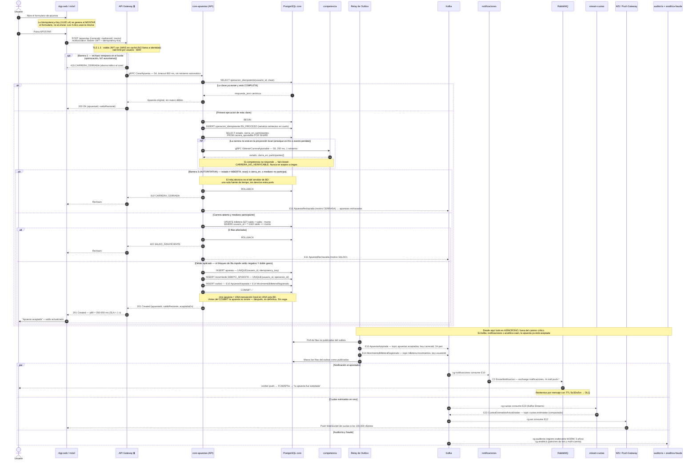
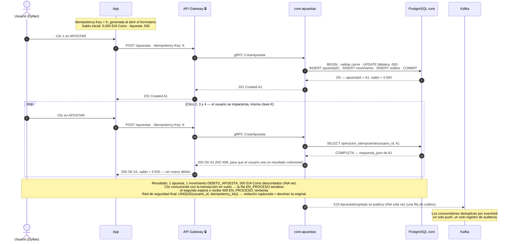

# Diagrama de secuencia — Flujo de una apuesta

> Entregable 12.2 del enunciado. Derivado de las decisiones de arquitectura:
> §2.1 (mapa de servicios), §3.1–3.2 (cero llamadas síncronas en el camino crítico),
> §4.4 (eventos E10/E11/E12/E14), §6.2 (idempotencia), §7.4–7.6 (cierre, saldo, latencia) y ADR-002.

## Leyenda

| Notación | Significado |
|---|---|
| `──▶` línea continua | Comunicación **síncrona** (HTTPS/REST o gRPC). El emisor espera respuesta |
| `╌╌▶` línea discontinua | Comunicación **asíncrona** (evento Kafka o comando RabbitMQ) o respuesta de retorno |
| `──✗` | Rechazo / cortocircuito |
| 🔒 | Frontera público ↔ privado. Solo `API Gateway`, `WS Gateway` y `CDN/WAF` son públicos |
| `alt / else` | Flujos alternativos mutuamente excluyentes |
| `opt` | Paso que puede no ocurrir |
| `par / and` | Ramas que ocurren en paralelo |
| `loop` | Repetición |

> **Coherencia con el diagrama general:** allí los comandos RabbitMQ se dibujan con línea
> gruesa, un grosor que el diagrama de secuencia de Mermaid no ofrece. Aquí van también en
> línea discontinua, pero rotulados explícitamente con su exchange y su *routing key*
> (`C2 EnviarNotificacion — exchange notificaciones, rk notif.push.*`), de modo que nunca se
> confunden con un evento Kafka, que siempre lleva su número `E##` y su topic.

**Idea central del diagrama:** el camino crítico (pasos 1 a 24) **no tiene ni una sola llamada
síncrona entre servicios de negocio**. Todo se decide dentro de `core-apuestas`, en una única
transacción local de una única base de datos. Lo demás cuelga del outbox y es asíncrono.

---

## 1. Flujo principal, con rechazos y camino de recuperación

### Pasos clave y su justificación arquitectónica

| Paso | Qué ocurre | Decisión que lo respalda |
|---|---|---|
| 2 | La `Idempotency-Key` se genera al **montar** el formulario, no al enviarlo | §6.2 — es lo que hace que los 4 clics compartan la misma clave |
| 5 | El gateway valida el JWT con **JWKS en caché**, sin llamar a `identidad` | §3.1 / S3 — `identidad` nunca está en el camino crítico de una apuesta |
| 6 | Barrera 1: rechazo en el borde, declarada **no autoritativa** | §7.4 — el reloj del gateway puede desviarse; solo ahorra tráfico |
| 8 | gRPC `CrearApuesta` con timeout 800 ms y **sin reintento automático** | S4 — reintentar una escritura es trabajo del cliente, con la misma clave |
| 9–13 | Fast-path de idempotencia y fila `EN_PROCESO` | §6.2 — serializa los reintentos concurrentes en la misma fila |
| 14–16 | `S6` a `competencia` **solo si falla la proyección local** | §3.2 — no está en el camino normal; si falla, *fail-closed* |
| 17–19 | Barrera 3: `now() >= cierra_en` evaluado **con el reloj de la BD** | §7.4 — una sola fuente de tiempo para decenas de pods |
| 22 | `UPDATE … WHERE saldo >= monto`: 0 filas = rechazo | §7.5 — ni saldo negativo ni doble gasto, con `READ COMMITTED` |
| 26–29 | `apuesta` + `movimiento` + `outbox` en la **misma transacción** | ADR-002 y §4.6 — cero sagas, cero eventos perdidos |
| 30 | `COMMIT`: antes la apuesta no existe, después es definitiva | §9.3 — la coherencia apuesta ↔ débito es atómica por construcción |
| 33 | `201 Created` con p99 ≈ 350–650 ms | §7.6 — presupuesto de latencia bajo el SLA de 1 s |
| 36–40 | El **relay de outbox** publica a Kafka después del commit | §4.6 — si el broker está caído, el negocio sigue aceptando apuestas |
| 41+ | Notificaciones, cuotas, auditoría y fraude: todo en paralelo | §8.1 — la caída de notificaciones **no** afecta a la apuesta |

### Presupuesto de latencia del camino crítico (§7.6)

| Tramo | Presupuesto |
|---|---|
| Red cliente → borde (móvil) | 150–300 ms |
| Gateway: TLS + JWT + rate limit | 5 ms |
| Gateway → core (gRPC, misma VPC) | 2 ms |
| Core: validaciones locales + transacción (5 sentencias) | 10–25 ms |
| Respuesta de vuelta | 150–300 ms |
| **Total p99** | **≈ 350–650 ms** ✅ |

### Rechazos posibles y su código

| Motivo | Dónde se detecta | Respuesta | Evento |
|---|---|---|---|
| Carrera cerrada / no abierta | Barrera 1 (borde) o Barrera 3 (BD, autoritativa) | `410 CARRERA_CERRADA` | E11 motivo `CERRADA` |
| Mediano no participa | Proyección local `participantes[]` | `422 MEDIANO_NO_PARTICIPA` | E11 |
| Saldo insuficiente | `UPDATE` condicional, 0 filas | `422 SALDO_INSUFICIENTE` | E11 motivo `SALDO` |
| Usuario bloqueado | JWT + proyección de bloqueados (E2) | `403 USUARIO_BLOQUEADO` | E11 motivo `BLOQUEADO` |
| Carrera no verificable | Falla `S6` a `competencia` | `503 CARRERA_NO_VERIFICABLE` | E11 |
| Apuesta duplicada | Fast-path o `UNIQUE(usuario_id, idempotency_key)` | `200 OK` con la apuesta original | — (no se duplica E10) |

---

## 2. Flujo alternativo obligatorio — los 4 clics (idempotencia)

> El enunciado considera este el corazón del ejercicio: *"Dyllan no quiere pagar dos veces"*.

**Tres capas de defensa, en orden de actuación:**

1. **Fast-path:** `SELECT operacion_idempotente(usuario_id, clave)` → si está `COMPLETA`, se devuelve la respuesta canónica guardada (TTL 7 días) sin abrir transacción de negocio.
2. **Serialización de concurrentes:** la fila `EN_PROCESO` hace que un segundo clic simultáneo espere o reciba `409 EN_PROCESO, reintenta`.
3. **Red de seguridad en la BD:** `UNIQUE (usuario_id, idempotency_key)` en `apuesta` y `UNIQUE (usuario_id, operacion_id)` en `movimiento`. Si la violación ocurre, se captura, se hace `ROLLBACK` y se devuelve la apuesta original.

La clave está **en el ámbito del usuario** (`usuario_id` + clave) para que nadie pueda adivinar
claves ajenas y leer o bloquear operaciones de otros (§6.2).

---

## 3. Archivos fuente

- [secuencia-apuesta-principal.mmd](secuencia-apuesta-principal.mmd) — flujo principal
- [secuencia-apuesta-idempotencia.mmd](secuencia-apuesta-idempotencia.mmd) — flujo de los 4 clics

Ambos en Mermaid: se renderizan en GitHub, VS Code, Notion, Obsidian o en
[mermaid.live](https://mermaid.live) para exportar PNG/SVG y pegarlos en la presentación.
