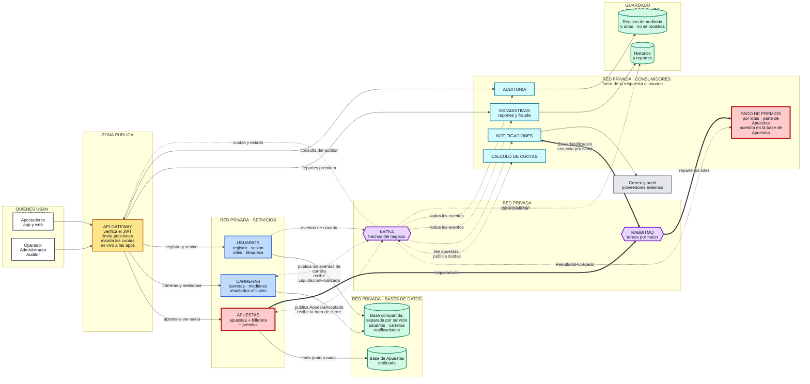
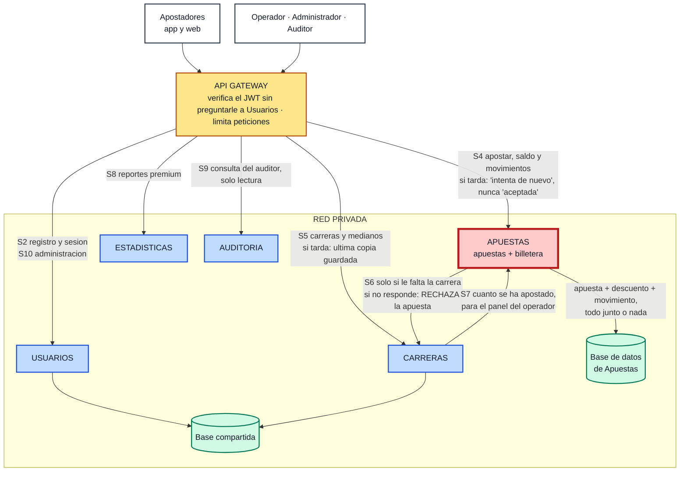

# Diagrama general de arquitectura — La Gran Liga de Apuestas de Medianos EIA

> Sale de `decisiones-arquitectura.md`. Cubre el entregable 12.1 del enunciado: el recorrido **cliente → API Gateway → servicios → bases de datos → Kafka / RabbitMQ → consumidores**, distinguiendo a la vista **lo síncrono de lo asíncrono**.

## Cómo se lee

| En el dibujo | Significa |
|---|---|
| **Línea continua** ──► | **Síncrono**: quien envía se queda esperando la respuesta. Aquí va lo que el usuario espera en pantalla |
| **Línea punteada** ╌╌► | **Evento en Kafka**: "esto ya pasó". Lo pueden leer varios servicios, cada uno a su ritmo |
| **Línea gruesa** ══► | **Tarea en RabbitMQ**: trabajo por hacer, que se reparte entre varios procesos y se puede reintentar |
| **Caja de borde rojo** | Es donde está el dinero: las apuestas, los saldos y los premios |
| **Caja amarilla** | El API Gateway: lo único alcanzable desde Internet |
| **Zonas con el título "RED PRIVADA"** | No tienen dirección pública: solo se llega a ellas desde adentro |

Hay **un diagrama principal** (el entregable) y **dos vistas de apoyo** que son el mismo sistema filtrado: una deja solo lo síncrono y la otra solo lo asíncrono. Sirven para explicar sin tener que seguir treinta flechas a la vez.

---

## 1. Diagrama general

**Las tres cosas que este dibujo tiene que dejar claras:**

1. **Apostar es un camino cortísimo.** Del apostador a la base de datos hay tres pasos: API Gateway → Apuestas → base de datos. Apuestas **no le pregunta nada a ningún otro servicio** para aceptar una apuesta, y por eso cabe en menos de un segundo con 10.000 apuestas por segundo.
2. **Todo lo punteado y lo grueso se puede caer sin que nadie deje de apostar.** Notificaciones, estadísticas, fraude, auditoría, cuotas en vivo, Kafka y RabbitMQ están fuera de esa respuesta. Eso contesta de un vistazo los casos A y B del enunciado.
3. **La caja roja es la respuesta a la pregunta difícil.** Apuestas y billetera están en la misma caja y en la misma base de datos **a propósito**: así no hay forma de gastar dos veces los mismos EIA Coins ni de quedar en saldo negativo.

---

## 2. Vista de apoyo: solo lo síncrono

Todo lo que aparece aquí ocurre **dentro del segundo** que el usuario espera. La única flecha que sale de Apuestas hacia otro servicio es la de excepción.

---

## 3. Vista de apoyo: solo los eventos y las tareas

Nada de esto está en la respuesta al usuario: todo puede retrasarse o caerse y la gente sigue apostando.

```mermaid
%%{init: {'flowchart': {'nodeSpacing': 30, 'rankSpacing': 55, 'curve': 'basis'}}}%%
flowchart TB
  subgraph P["QUIEN PUBLICA"]
    direction LR
    APU["APUESTAS<br/>ApuestaAceptada · ApuestaRechazada<br/>MovimientoBilleteraRegistrado"]
    CAR["CARRERAS<br/>CarreraProgramada · CarreraAbierta<br/>CarreraCerrada · CarreraIniciada<br/>CarreraCancelada · ResultadoPublicado<br/>ResultadoCorregido"]
    USU["USUARIOS<br/>UsuarioRegistrado<br/>UsuarioEstadoCambiado"]
    PRE2["PAGO DE PREMIOS<br/>LiquidacionCalculada<br/>LiquidacionFinalizada"]
  end

  subgraph M["MENSAJERIA ADMINISTRADA"]
    direction LR
    KAF{{"KAFKA · 8 temas<br/>guarda los hechos una semana<br/>y se pueden volver a leer"}}
    RAB{{"RABBITMQ<br/>colas de tareas, con reintentos<br/>y cola de mensajes con problemas"}}
  end

  subgraph C["QUIEN LEE"]
    direction LR
    PRE["PAGO DE PREMIOS"]
    CUO["CALCULO DE CUOTAS"]
    NOT["NOTIFICACIONES<br/>un proceso por canal:<br/>correo · push · app"]
    EST["ESTADISTICAS<br/>y fraude"]
    AUD["AUDITORIA"]
    APU2["APUESTAS<br/>su copia de las carreras<br/>y de los bloqueados"]
    CAR2["CARRERAS<br/>marca la carrera<br/>como LIQUIDADA"]
    GW["API GATEWAY<br/>manda las cuotas a las apps"]
  end

  subgraph D["A DONDE VA A PARAR"]
    direction LR
    HIS[("Historico y reportes")]
    REG[("Registro de auditoria<br/>5 anos, no se modifica")]
    EXT["Correo y push<br/>proveedores externos"]
    APPS["Apps de los apostadores"]
  end

  APU -.-> KAF
  CAR -.-> KAF
  USU -.-> KAF
  PRE2 -.-> KAF

  KAF -.->|"ResultadoPublicado<br/>ResultadoCorregido"| PRE
  KAF -.->|"ApuestaAceptada"| CUO
  KAF -.->|"apuestas, carreras y movimientos"| NOT
  KAF -.->|"todos los eventos"| EST
  KAF -.->|"todos los eventos"| AUD
  KAF -.->|"CarreraAbierta con la hora de cierre<br/>CarreraCancelada · usuarios bloqueados"| APU2
  KAF -.->|"LiquidacionFinalizada"| CAR2
  KAF -.->|"CuotasEstimadasActualizadas"| GW
  CUO -.->|"suma cada segundo y publica"| KAF

  APU ==>|"LiquidarLote: lotes de 1.000 apuestas"| RAB
  RAB ==>|"se reparte entre los procesos libres"| PRE
  NOT <==>|"EnviarNotificacion<br/>una cola por canal"| RAB

  EST --> HIS
  KAF -.->|"copia continua"| HIS
  AUD --> REG
  NOT --> EXT
  GW --> APPS

  classDef servicio fill:#bfdbfe,stroke:#1d4ed8,stroke-width:2px,color:#111827
  classDef dinero fill:#fecaca,stroke:#b91c1c,stroke-width:4px,color:#111827
  classDef cola fill:#e9d5ff,stroke:#7e22ce,stroke-width:3px,color:#111827
  classDef consumidor fill:#cffafe,stroke:#0e7490,stroke-width:2px,color:#111827
  classDef datos fill:#d1fae5,stroke:#047857,stroke-width:2px,color:#111827
  classDef externo fill:#e5e7eb,stroke:#6b7280,stroke-width:2px,color:#111827
  classDef publico fill:#fde68a,stroke:#b45309,stroke-width:2px,color:#111827
  class APU,PRE,PRE2,APU2 dinero
  class CAR,USU,CAR2 servicio
  class KAF,RAB cola
  class CUO,NOT,EST,AUD consumidor
  class GW publico
  class HIS,REG datos
  class EXT,APPS externo
```

---

## 4. El detalle que las flechas abrevian

### 4.1 Flechas síncronas

Los códigos son los mismos de la tabla de la decisión 3 en `decisiones-arquitectura.md`.

| Código | De → a | Protocolo | Qué pide | Si no responde a tiempo |
|---|---|---|---|---|
| S1 | App del usuario → API Gateway | REST sobre HTTPS | Todas las operaciones del usuario | La app reintenta con la misma clave de la operación, así que no se duplica nada |
| S2 | API Gateway → Usuarios | REST | Registro e inicio de sesión | Un reintento y, si falla, "intenta más tarde". Las sesiones ya abiertas siguen funcionando |
| S3 | API Gateway → Usuarios | REST | Las claves públicas para verificar los JWT, cada cierto tiempo | Se usa la última copia guardada: no es una llamada por petición |
| S4 | API Gateway → Apuestas | gRPC | Crear apuesta, saldo, mis apuestas y movimientos | Se corta la espera y se responde "intenta de nuevo". **Nunca se responde "aceptada" si no quedó guardada** |
| S5 | API Gateway → Carreras | REST | Lista de carreras, detalle, ficha de un mediano | Un reintento y, si falla, la última copia guardada |
| S6 | Apuestas → Carreras | gRPC, **solo por excepción** | Los datos de una carrera que no está en su copia local | **Se rechaza la apuesta.** Mejor rechazar que aceptar una apuesta de una carrera que quizá ya cerró |
| S7 | Carreras → Apuestas | gRPC | Cuánto se ha apostado, para el panel del operador | Se muestra el último valor conocido, marcado como aproximado |
| S8 | API Gateway → Estadísticas | REST | Reportes premium y tendencias | Se entrega el reporte del día anterior |
| S9 | API Gateway → Auditoría | REST, solo lectura | Historial de una carrera y cómo se calcularon sus premios | Se entrega por partes o se deja listo para descargar |
| S10 | API Gateway → Usuarios / Carreras | REST, por red privada | Administración: roles, bloqueos, crear o cancelar carrera, publicar resultado | No se reintenta sola; el operador la repite y la clave de la operación evita aplicarla dos veces |
| S11 | Envío por canal → proveedores de correo y push | HTTPS | Entregar el mensaje | Se reintenta con esperas crecientes desde RabbitMQ. **Nunca afecta al que está apostando** |

### 4.2 Flechas punteadas: lo que viaja por Kafka

Todos los servicios publican **desde su tabla de salida**: el evento se guarda junto con el cambio, y otro proceso lo publica después. Así, si Kafka está caído, no se pierde ningún evento ni se frena ninguna apuesta.

| Quién publica | Eventos | Tema (topic) | Particiones | Clave de reparto |
|---|---|---|---|---|
| Apuestas | `ApuestaAceptada` | `apuestas.aceptadas` | 24 | `carreraId` |
| Apuestas | `ApuestaRechazada` | `apuestas.rechazadas` | 6 | `carreraId` |
| Apuestas | `MovimientoBilleteraRegistrado` | `billetera.movimientos` | 24 | `usuarioId` |
| Carreras | `CarreraProgramada`, `CarreraAbierta`, `CarreraCerrada`, `CarreraIniciada`, `CarreraCancelada` | `carreras.eventos` | 6 | `carreraId` |
| Carreras | `ResultadoPublicado`, `ResultadoCorregido` | `carreras.resultados` | 6 | `carreraId` |
| Usuarios | `UsuarioRegistrado`, `UsuarioEstadoCambiado` | `usuarios.eventos` | 3 | `usuarioId` |
| Pago de premios | `LiquidacionCalculada`, `LiquidacionFinalizada` | `premios.eventos` | 6 | `carreraId` |
| Cálculo de cuotas | `CuotasEstimadasActualizadas` | `cuotas.estimadas` | 6 | `carreraId` |

Cada servicio que lee tiene su **propio grupo de consumidores**, así que lleva su propia posición de lectura y no estorba a los demás:

| Quién lee | Qué lee y para qué |
|---|---|
| **Apuestas** | `CarreraAbierta` (es el que le trae la **hora de cierre** y los participantes), `CarreraCerrada`, `CarreraCancelada` (devuelve el 100 %) y los eventos de usuario (lista de bloqueados) |
| **Pago de premios** | `ResultadoPublicado` y `ResultadoCorregido`: son los que disparan el cálculo y el pago |
| **Carreras** | `LiquidacionFinalizada`: con eso marca la carrera como LIQUIDADA |
| **Cálculo de cuotas** | `ApuestaAceptada`: va sumando por mediano y publica la cuota estimada cada segundo |
| **API Gateway** | `CuotasEstimadasActualizadas`, `CarreraCerrada` y `CarreraIniciada`, para mandárselos a las apps |
| **Notificaciones** | `ApuestaAceptada`, los eventos de carrera, `ResultadoPublicado` y los movimientos de billetera (de ahí filtra los premios y las devoluciones) |
| **Estadísticas y fraude** | **Todos** los eventos: de ahí salen los reportes y las reglas contra el fraude |
| **Auditoría** | **Todos** los eventos, que van al registro que no se puede modificar |

### 4.3 Flechas gruesas: lo que viaja por RabbitMQ

| Tarea | Exchange | Routing key | Cola → quién la ejecuta |
|---|---|---|---|
| `LiquidarLote` | `liquidacion` (direct) | `liquidacion.lote` | `q.liquidacion.lotes` → varios procesos de pago en paralelo. Si uno falla demasiadas veces, el lote se aparta en `q.liquidacion.lotes.dlq` y genera una alerta |
| `EnviarNotificacion` | `notificaciones` (topic) | `notif.email.*`, `notif.push.*`, `notif.inapp.*` | `q.notif.email`, `q.notif.push`, `q.notif.inapp` → un proceso por canal. Los fallos esperan en `q.notif.retry` (5 s, 30 s, 5 min) y, tras cinco intentos, pasan a `q.notif.dlq` |
| `RecalcularEstadisticas` | `estadisticas` (direct) | `estadisticas.recalculo` | `q.estadisticas.recalculo` → procesos de cálculo |

---

## 5. Comprobación contra el enunciado

| Lo que pide el entregable 12.1 | Dónde se ve |
|---|---|
| El recorrido cliente → API Gateway → servicios → bases de datos → Kafka / RabbitMQ → consumidores | Las siete zonas del diagrama general, en ese orden de izquierda a derecha |
| **Diferenciar lo síncrono de lo asíncrono** | Tres tipos de línea (continua, punteada y gruesa) y, además, dos vistas separadas: una solo síncrona y otra solo asíncrona |
| Qué es público y qué es privado | La caja amarilla de el API Gateway es lo único público; todas las demás zonas dicen "RED PRIVADA" en su título |
| Los servicios que decidimos | Los seis, con lo que contiene cada uno escrito adentro: medianos y resultados dentro de Carreras, y billetera y premios dentro de Apuestas |
| Las bases de datos y cómo se reparten | Una dedicada para Apuestas, una compartida y separada por servicio para Usuarios, Carreras y Notificaciones, más el histórico y el registro de auditoría |
| Los brokers y sus consumidores | Kafka y RabbitMQ en su propia zona, con cada consumidor dibujado y detallado en la sección 4 |

---

## 6. Notas de uso

- Los tres bloques son Mermaid y se ven directo en GitHub, VS Code y [mermaid.live](https://mermaid.live), desde donde se exportan a PNG o SVG para la presentación.
- El archivo fuente del diagrama general es [diagramas/general.mmd](diagramas/general.mmd), y es el mismo contenido del bloque de la sección 1.
- Para la diapositiva va el **diagrama general** (sección 1). Las dos vistas de apoyo sirven para explicar "cómo se acepta una apuesta" y "cómo se enteran los demás", que son dos diapositivas distintas.
- Si algún programa no acepta la primera línea (`%%{init ...}`), se puede borrar: el diagrama sigue siendo válido y solo cambia el espaciado.
- Los nombres de los eventos y los códigos S1…S11 son los mismos de `decisiones-arquitectura.md` y de `diagrama-secuencia-apuesta.md`, para que se pueda seguir la misma apuesta de un documento al otro.
