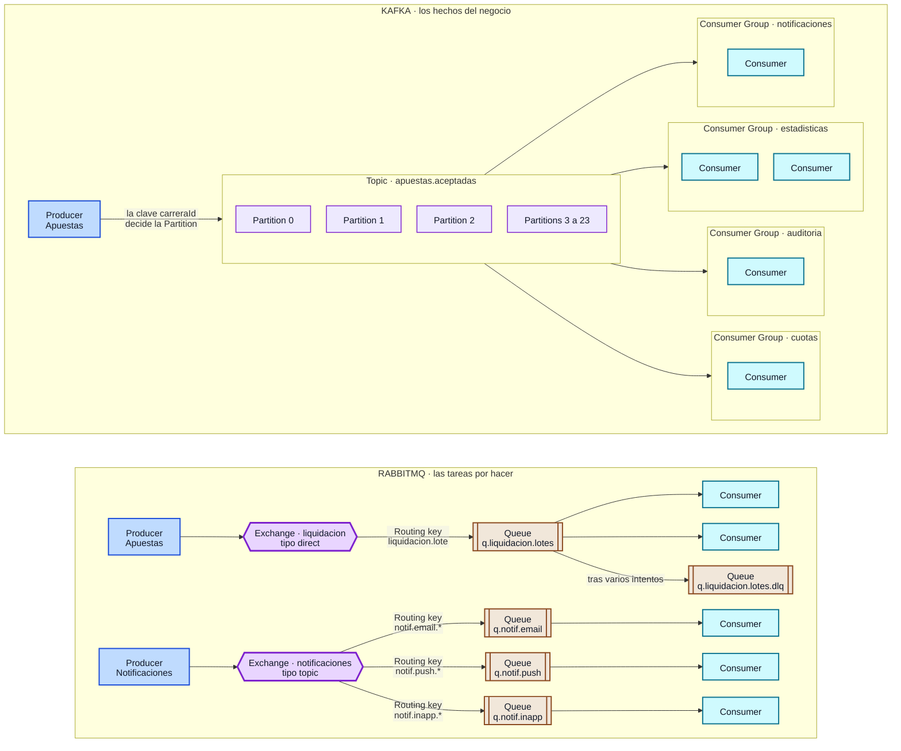

# Diseño de la mensajería — La Gran Liga de Apuestas de Medianos EIA

> Sale de `decisiones-arquitectura.md` (decisiones 4 y 5). Cubre el entregable 12.3 del enunciado: **el diseño de la mensajería**, con los elementos que pide explícitamente.
>
> No hay nada que configurar ni ejecutar: esto es el diseño.

## Qué pide el enunciado y dónde está en el dibujo

| Lo que pide | Dónde se ve |
|---|---|
| **Producer** (Kafka y RabbitMQ) | Las cajas azules: Apuestas publica en los dos, y Notificaciones publica en RabbitMQ |
| **Topic** | `apuestas.aceptadas`, el recuadro que agrupa las Partitions |
| **Partitions** | Las 24 del topic. Dibujamos las tres primeras y resumimos el resto |
| **Consumer Groups** | Los cuatro recuadros de la derecha: estadisticas, auditoria, cuotas y notificaciones |
| **Consumers** | Las cajas celestes dentro de cada grupo. Un grupo puede tener varios |
| **Exchange** | Los dos hexágonos: `liquidacion`, de tipo direct, y `notificaciones`, de tipo topic |
| **Routing** | Las etiquetas sobre las flechas que salen del Exchange: la routing key decide a qué Queue va el mensaje |
| **Queue** | Las cajas de borde café: una por tarea y una por canal, más la de los mensajes con problemas |
| **Consumer** (RabbitMQ) | Las cajas celestes al final de cada Queue |

---

## El diagrama

---

## Cómo leerlo

**Kafka, arriba.** Apuestas publica el hecho `ApuestaAceptada` en el **Topic** `apuestas.aceptadas`. La clave `carreraId` decide en qué **Partition** cae cada mensaje, y eso garantiza que todas las apuestas de una misma carrera lleguen **en orden** al mismo consumidor. Cuatro **Consumer Groups** leen ese mismo topic, cada uno por su cuenta y a su ritmo: lo que lee auditoría no le quita nada a estadísticas. Dentro de un grupo, los **Consumers** se reparten las particiones, así que agregar consumidores a un grupo aumenta su velocidad hasta el número de particiones.

**RabbitMQ, abajo.** Aquí no se publica un hecho, se encarga una tarea. El **Producer** manda el mensaje a un **Exchange**, y la **routing key** decide a qué **Queue** va: `liquidacion.lote` lleva cada lote de pagos a `q.liquidacion.lotes`, donde varios **Consumers** se los reparten —el que esté libre toma el siguiente—; y `notif.email.*`, `notif.push.*` y `notif.inapp.*` llevan cada aviso a la cola de su canal, de modo que un canal caído no frena a los otros. Si una tarea falla demasiadas veces, pasa a la **Queue** de mensajes con problemas en vez de bloquear a las que vienen detrás.

**La diferencia en una línea:** en Kafka el mensaje se queda y lo leen todos los que quieran; en RabbitMQ el mensaje se entrega a uno y desaparece cuando queda hecho.

---

## Notas de uso

- El bloque es Mermaid y se ve directo en GitHub, VS Code y [mermaid.live](https://mermaid.live).
- Archivo fuente: [diagramas/mensajeria.mmd](diagramas/mensajeria.mmd).
- En la presentación está en la diapositiva 9: el botón **Ver el diseño completo** lo abre en grande, con zoom y descarga.
- Los nombres de topics, exchanges, colas y claves son los mismos de `decisiones-arquitectura.md` y de `diagrama-general.md`.
