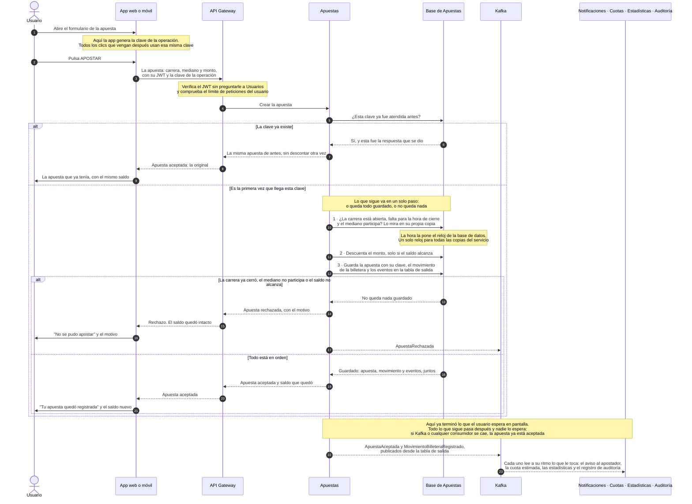
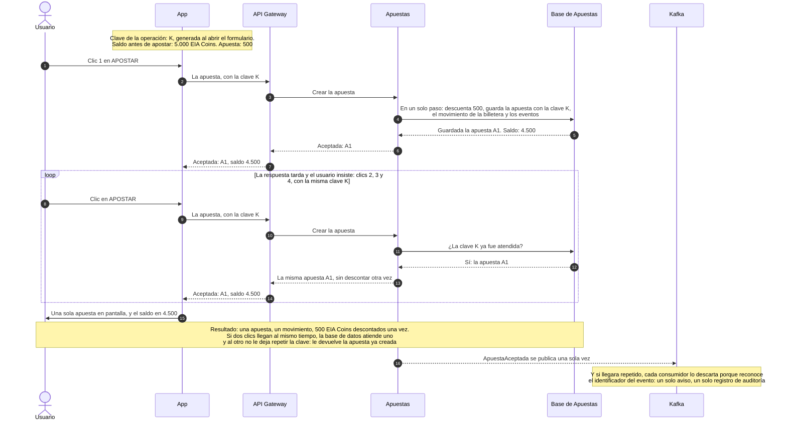

# Diagrama de secuencia — el camino de una apuesta

> Sale de `decisiones-arquitectura.md` (sección 14). Cubre el entregable 12.2 del enunciado: **desde que el usuario pulsa APOSTAR hasta que recibe la confirmación, incluyendo el descuento en la billetera.**

## Cómo se lee

| En el dibujo | Significa |
|---|---|
| **Flecha llena** ──► | Alguien pide algo y **se queda esperando** la respuesta |
| **Flecha punteada** ╌╌► | La respuesta de vuelta, o un evento que se publica en Kafka y nadie espera |
| **`alt` / `else`** | Caminos alternativos: ocurre uno o el otro, nunca los dos |
| **`loop`** | Algo que se repite |

Hay **dos dibujos**: el camino completo de una apuesta, con sus rechazos, y el caso de los cuatro clics, que es el que el enunciado llama el corazón del ejercicio.

**La idea que el primer dibujo tiene que dejar clara:** mientras el usuario espera, **Apuestas no le pregunta nada a ningún otro servicio**. Todo se decide dentro de Apuestas, en un solo paso contra su propia base de datos. Lo demás ocurre después y nadie lo espera.

---

## 1. El camino de una apuesta

### Los pasos, en una frase cada uno

| Paso | Qué pasa | Por qué así |
|---|---|---|
| 1 | La app genera la **clave de la operación al abrir el formulario**, no al pulsar el botón | Es lo que hace que los cuatro clics manden la misma clave. Si se generara al pulsar, cada clic sería una apuesta distinta |
| 3–4 | El API Gateway verifica el JWT y el límite de peticiones | No le pregunta nada a Usuarios: usa las claves de verificación que ya tiene guardadas. Así Usuarios nunca está en el camino de una apuesta |
| 5 | Apuestas pregunta si esa clave ya fue atendida | Es la primera defensa contra el doble clic, y la más barata |
| 6–9 | Si la clave ya existe, **devuelve la misma apuesta**, sin descontar otra vez | El usuario ve un resultado coherente: su apuesta, una sola, con un solo descuento |
| 10–12 | Revisar la carrera, descontar y guardar: **un solo paso** | O queda la apuesta con su descuento, o no queda nada. Nunca una apuesta sin descuento ni un descuento sin apuesta |
| 10 | La hora de cierre se compara con **el reloj de la base de datos** | Todas las copias del servicio usan el mismo reloj, así que ninguna acepta algo que otra rechazaría |
| 11 | Se descuenta **solo si el saldo alcanza** | Es lo que hace imposible que el saldo quede negativo y que se gasten dos veces los mismos EIA Coins |
| 12 | La apuesta se guarda **con su clave**, y la clave no se puede repetir | Red de seguridad final: si dos clics entran a la vez, la base de datos deja pasar uno solo |
| 13–17 | Si algo no cuadra, no queda nada guardado y se avisa el motivo | El saldo queda intacto. El rechazo también se publica, porque el módulo de fraude necesita verlo |
| 19–21 | La respuesta "aceptada" sale **después** de que todo quedó guardado | Nunca se responde "aceptada" si la apuesta no quedó guardada |
| 22 | Los eventos salen de la **tabla de salida** hacia Kafka | El evento se guardó junto con la apuesta. Si Kafka está caído, las apuestas siguen y los eventos salen cuando vuelva |
| 23 | Avisos, cuotas, estadísticas y auditoría, cada uno a su ritmo | Que se caiga cualquiera de ellos no afecta a quien está apostando. Son los casos A y B del enunciado |

---

## 2. Los cuatro clics

> *"Dyllan no quiere pagar dos veces."* El estudiante apuesta 500 EIA Coins, la app tarda en responder y pulsa APOSTAR cuatro veces.

**Tres defensas, en el orden en que actúan:**

1. **La más barata:** Apuestas pregunta si la clave ya fue atendida y, si lo fue, devuelve la respuesta que ya había dado. Esa respuesta se guarda unos días.
2. **La que resuelve los clics simultáneos:** si dos llegan al mismo tiempo, la base de datos los atiende de uno en uno.
3. **La que no se puede saltar:** la clave de la operación **no se puede repetir** para un mismo usuario. Si aun así se intenta, la base de datos no deja insertar y Apuestas devuelve la apuesta original.

La clave va siempre **junto con el usuario**, para que nadie pueda adivinar la clave de otro y leer o estorbar sus operaciones.

---

## 3. Cuándo se rechaza una apuesta

| Motivo | Dónde se detecta | Qué ve el usuario | Qué queda registrado |
|---|---|---|---|
| La carrera ya cerró o no está abierta | En el API Gateway, que ya sabe la hora de cierre, y en todo caso en la base de datos, que es la que decide | "La carrera ya cerró" | `ApuestaRechazada`, motivo cierre |
| El mediano no participa en la carrera | En la copia de la carrera que tiene Apuestas | "Ese mediano no corre esta carrera" | `ApuestaRechazada` |
| El saldo no alcanza | En el descuento, que solo se aplica si alcanza | "No tienes EIA Coins suficientes" | `ApuestaRechazada`, motivo saldo |
| El usuario está bloqueado | En el JWT y en la lista de bloqueados que mantiene Apuestas | "Tu cuenta está bloqueada" | `ApuestaRechazada` |
| La apuesta está repetida | En la clave de la operación | **No es un rechazo:** ve su apuesta, una sola | Nada nuevo: no se publica un segundo evento |

En los rechazos **el saldo nunca se toca**. Y en ningún caso se responde "aceptada" antes de que la apuesta esté guardada: si el servicio se cae justo entre guardar y responder, la app reintenta con la misma clave y recibe la apuesta que ya existía.

---

## 4. Lo que dejamos fuera del dibujo a propósito

| Lo que no está dibujado | Por qué |
|---|---|
| La llamada de Apuestas a Carreras (S6) | Solo ocurre si Apuestas acaba de arrancar o se perdió un evento, nunca en el camino normal. Si Carreras no responde, **se rechaza la apuesta**: mejor rechazar que aceptar una apuesta de una carrera que quizá ya cerró |
| Los tiempos de respuesta en milisegundos | La mayor parte del segundo se la lleva la red del celular. El sistema hace tres cosas: verificar el JWT, una llamada interna y un paso de base de datos. Son requisitos de diseño, no mediciones: el siguiente paso sería probarlo con carga real |
| El pago de premios | Ocurre cuando termina la carrera, no cuando se apuesta. Va por RabbitMQ, en lotes, y tiene su propio camino |
| Las colas de RabbitMQ para los avisos | Están en el diagrama general. Aquí solo interesa que el aviso sale **después** de la respuesta al usuario |

---

## 5. Comprobación contra el enunciado

| Lo que pide el entregable 12.2 | Dónde se ve |
|---|---|
| Desde que el usuario pulsa APOSTAR hasta la confirmación | Dibujo 1, de principio a fin |
| **El descuento en la billetera** | Paso 11, dentro del mismo paso que guarda la apuesta |
| Que una apuesta no se procese cuatro veces | Dibujo 2 completo, y los pasos 5 a 9 del dibujo 1 |
| Que ninguna apuesta se acepte después del cierre | Paso 10 y la nota del reloj de la base de datos |
| Que el saldo nunca quede negativo | Paso 11: se descuenta solo si alcanza |
| Que una falla de notificaciones no impida apostar | La nota antes del paso 22: todo lo de abajo ocurre después de la respuesta |
| Distinguir lo síncrono de lo asíncrono | Flechas llenas mientras el usuario espera; punteadas hacia Kafka y los consumidores |

---

## 6. Notas de uso

- Los dos bloques son Mermaid: se ven directo en GitHub, VS Code y [mermaid.live](https://mermaid.live), desde donde se exportan a PNG o SVG para la presentación.
- Archivos fuente: [diagramas/secuencia-apuesta.mmd](diagramas/secuencia-apuesta.mmd) y [diagramas/secuencia-cuatro-clics.mmd](diagramas/secuencia-cuatro-clics.mmd). Son el mismo contenido de los bloques de arriba.
- Para la diapositiva va el **dibujo 1**. El **dibujo 2** merece su propia diapositiva: es la que responde la pregunta que con más seguridad van a hacer en la sustentación.
- Los nombres de los servicios y de los eventos son los mismos de `decisiones-arquitectura.md` y de `diagrama-general.md`, para poder seguir la misma apuesta de un documento al otro.
